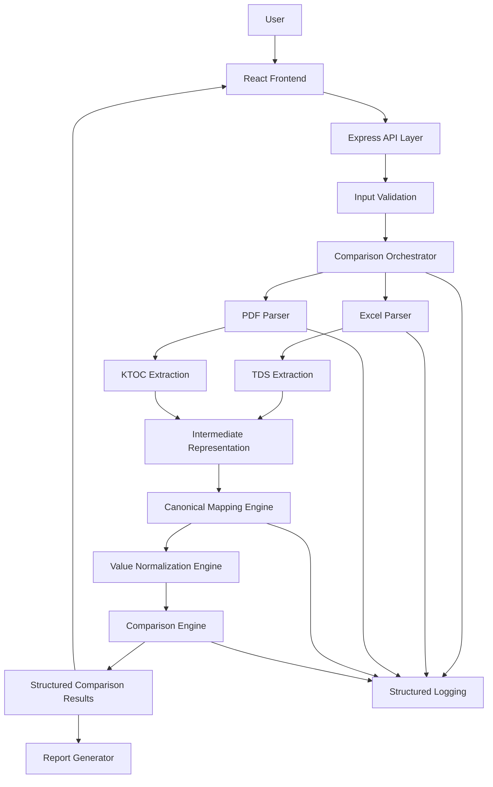
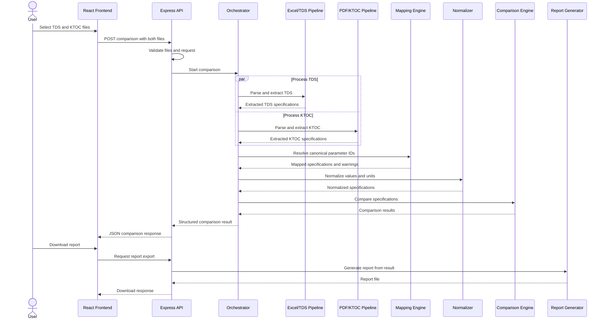

# KONE TDS–KTOC Compliance Checker

# System Design Document (SDD)

| Attribute | Details |
|---|---|
| Project | KONE TDS–KTOC Compliance Checker |
| Document Version | 1.0 |
| Status | Proposed |
| Architecture | Modular Monolith |
| Frontend | React + TypeScript |
| Backend | Node.js + Express + TypeScript |
| Input Formats | Excel (`.xlsx`), PDF (`.pdf`) |
| Data Persistence | None in MVP |
| Processing Model | Synchronous, in-memory comparison |
| Primary Responsibility | Extract, map, normalize, compare, and report elevator specifications |

---

# 1. Purpose

This document defines the technical architecture of the KONE TDS–KTOC Compliance Checker.

The application compares technical specifications in a customer-provided Technical Data Sheet (TDS) against specifications in a KONE ERP-generated KTOC order form.

The two documents may describe equivalent technical parameters using different terminology, formatting, or units. The system must identify corresponding parameters, normalize their values, and determine whether the specifications agree.

The design prioritizes:

- Deterministic comparison logic.
- Traceability to source documents.
- Explicit handling of uncertain extraction and mapping.
- Independent, testable modules.
- Minimal infrastructure.
- No database or unnecessary persistence.
- Human review for unresolved or potentially consequential discrepancies.

This document describes the proposed implementation architecture. Exact parsing rules, parameter mappings, and comparison tolerances must be validated against representative TDS and KTOC documents.

---

# 2. System Requirements

## 2.1 Functional Requirements

The system must:

1. Accept one Excel TDS and one KTOC PDF per comparison.
2. Validate and parse both documents.
3. Extract supported elevator parameters and their source locations.
4. Map source terminology to canonical parameter identifiers.
5. Normalize numeric values and supported units.
6. Compare corresponding specifications.
7. Classify matches, mismatches, missing parameters, and unresolved cases.
8. Return structured results to the frontend.
9. Export the results into a downloadable report.
10. Clean up temporary files and processing data according to the defined lifecycle.

## 2.2 Non-Functional Requirements

- Deterministic comparison results.
- Independent unit testing of the comparison engine.
- No permanent storage of uploaded documents in the MVP.
- Controlled memory and processing consumption.
- Safe handling of invalid documents.
- Structured, privacy-conscious logging.
- Clear separation between extraction failures and genuine specification discrepancies.
- No external AI or cloud processing without organizational approval.

---

# 3. High-Level Architecture

The application will use a **modular monolith**: a single backend deployment containing multiple independently testable modules.

The frontend handles document uploads and report presentation. The backend orchestrates processing, while the individual modules handle extraction, mapping, normalization, comparison, and reporting.

## 3.1 Architecture Diagram



## 3.2 Architectural Decisions

| Decision | Choice | Reason |
|---|---|---|
| Backend architecture | Modular monolith | Small scope and low operational overhead |
| API framework | Express | Straightforward request handling and middleware |
| Language | TypeScript | Shared types and compile-time checks |
| Processing | Synchronous initially | Avoid queues and background infrastructure until needed |
| State | In-memory | No persistent order history required |
| Mapping | Explicit dictionary and deterministic rules | Predictable and auditable behavior |
| Comparison | Pure functions | Easy unit testing and reproducibility |
| Reporting | Generated from structured results | Prevent discrepancies between UI and exported report |
| Logging | Structured application logs | Diagnose failures without retaining document contents |
| AI dependency | None required | Avoid nondeterministic compliance decisions and external data exposure |

---

# 4. Repository Structure

The codebase should be organized by responsibility rather than putting all backend logic into one file.

```text
kone-compliance-checker/
│
├── README.md
├── PRD.md
├── API_DESIGN.md
├── SYSTEM_DESIGN.md
├── LOGGING.md
├── package.json
├── tsconfig.json
├── .gitignore
│
├── frontend/
│   ├── src/
│   │   ├── components/
│   │   │   ├── FileUpload.tsx
│   │   │   ├── ComparisonSummary.tsx
│   │   │   ├── ComparisonTable.tsx
│   │   │   ├── StatusFilter.tsx
│   │   │   └── ProcessingStatus.tsx
│   │   │
│   │   ├── pages/
│   │   │   └── ComparisonPage.tsx
│   │   │
│   │   ├── services/
│   │   │   └── comparisonApi.ts
│   │   │
│   │   ├── types/
│   │   │   └── comparison.ts
│   │   │
│   │   └── App.tsx
│   │
│   └── tests/
│
├── backend/
│   ├── src/
│   │   ├── app.ts
│   │   ├── server.ts
│   │   │
│   │   ├── routes/
│   │   │   ├── comparison.routes.ts
│   │   │   └── health.routes.ts
│   │   │
│   │   ├── controllers/
│   │   │   └── comparison.controller.ts
│   │   │
│   │   ├── middleware/
│   │   │   ├── errorHandler.ts
│   │   │   └── requestContext.ts
│   │   │
│   │   ├── validators/
│   │   │   └── upload.validator.ts
│   │   │
│   │   ├── orchestrators/
│   │   │   └── comparison.orchestrator.ts
│   │   │
│   │   ├── parsers/
│   │   │   ├── excel.parser.ts
│   │   │   └── pdf.parser.ts
│   │   │
│   │   ├── extractors/
│   │   │   ├── tds.extractor.ts
│   │   │   └── ktoc.extractor.ts
│   │   │
│   │   ├── mapping/
│   │   │   ├── canonical-mapping.ts
│   │   │   └── mapping-rules.json
│   │   │
│   │   ├── normalization/
│   │   │   ├── value-normalizer.ts
│   │   │   └── unit-converter.ts
│   │   │
│   │   ├── comparison/
│   │   │   ├── comparison.engine.ts
│   │   │   └── comparison-rules.ts
│   │   │
│   │   ├── reporting/
│   │   │   └── report.generator.ts
│   │   │
│   │   ├── logging/
│   │   │   └── logger.ts
│   │   │
│   │   ├── cleanup/
│   │   │   └── temporary-files.ts
│   │   │
│   │   └── types/
│   │       ├── document.ts
│   │       ├── specification.ts
│   │       └── comparison.ts
│   │
│   └── tests/
│       ├── unit/
│       ├── integration/
│       └── fixtures/
│
└── docs/
    └── decisions/
```

The exact layout can evolve during implementation. For a small MVP, some files can be combined initially, but parsing, mapping, normalization, and comparison must remain logically independent.

---

# 5. Component Design

## 5.1 Frontend

**Responsibility:** Collect the two documents, initiate comparisons, and present the results.

### Components

| Component | Responsibility |
|---|---|
| `FileUpload` | Select and validate document types at the UI level |
| `ProcessingStatus` | Display upload, processing, success, and error states |
| `ComparisonSummary` | Display counts by comparison status |
| `ComparisonTable` | Display parameter-level results |
| `StatusFilter` | Filter results by match, mismatch, missing, or review status |
| `comparisonApi` | Encapsulate HTTP requests and report downloads |

### Frontend rules

- Do not implement technical compliance logic in React.
- Do not trust client-side file validation as the security boundary.
- Display the original labels and source values returned by the backend.
- Display unresolved and incomplete processing states prominently.
- Do not display a successful compliance summary when required parameters remain unresolved.
- Avoid retaining document contents in browser storage.

The frontend is a presentation layer. The backend remains the source of truth for all classifications.

## 5.2 API Layer

**Responsibility:** Expose a controlled HTTP interface to the frontend.

The API layer handles:

- Request parsing.
- File-upload middleware.
- Input validation.
- Correlation identifier assignment.
- Controller invocation.
- Response serialization.
- Centralized error handling.

It must not contain document-specific parsing rules or comparison logic.

## 5.3 Comparison Orchestrator

**Responsibility:** Coordinate the complete comparison workflow.

The orchestrator:

1. Receives validated document inputs.
2. Invokes the TDS and KTOC extraction pipelines.
3. Checks whether required extraction steps completed.
4. Passes extracted specifications to the mapping engine.
5. Normalizes values.
6. Invokes the comparison engine.
7. Builds the final comparison result.
8. Returns warnings and diagnostics.
9. Ensures temporary resources are cleaned up.

The orchestrator coordinates modules but does not implement their internal algorithms.

## 5.4 Excel Parser and TDS Extractor

These are separate logical responsibilities.

The Excel parser reads the workbook and exposes worksheet data, cell values, and structural information.

The TDS extractor interprets that information to identify supported parameters.

This separation prevents the application from confusing a low-level Excel parsing problem with a failure to recognize a particular technical parameter.

The parser must account for:

- Multiple worksheets.
- Different table layouts.
- Merged cells, where relevant.
- Blank cells.
- Formula cells and cached formula results.
- Repeated parameter labels.
- Unexpected workbook structures.

The actual supported layouts must be established using representative TDS files.

## 5.5 PDF Parser and KTOC Extractor

The PDF parser extracts available text and structural information from the document.

The KTOC extractor identifies the relationship between labels, values, units, and page locations.

PDF extraction must not assume that adjacent text always belongs to the same parameter. Tables, line wrapping, repeated headers, and column ordering can make that assumption false.

For scanned pages, the application must detect that ordinary text extraction is insufficient. OCR should be introduced only if required and approved.

## 5.6 Canonical Mapping Engine

**Responsibility:** Resolve different labels that refer to the same technical parameter.

The engine uses an explicit mapping dictionary and deterministic normalization rules.

Example mapping configuration:

```json
{
  "car_width": {
    "canonicalLabel": "Car Width",
    "aliases": [
      "Car Width",
      "Cabin Width"
    ],
    "valueType": "number",
    "canonicalUnit": "mm",
    "mappingStatus": "approved"
  }
}
```

This is an illustrative configuration. Actual aliases must be validated against the documents and approved terminology.

### Mapping sequence

1. Normalize harmless formatting differences in the source label.
2. Check for an exact approved alias.
3. Apply an explicitly defined deterministic mapping rule, if applicable.
4. Detect whether more than one canonical parameter is plausible.
5. Return a confirmed mapping, an unmapped result, or an ambiguous mapping.

### Important constraints

- Do not use substring similarity alone to establish technical equivalence.
- Do not map parameters solely because they share units.
- Do not use an LLM's unsupported inference as an authoritative mapping.
- Preserve the original label.
- Record the rule responsible for each confirmed mapping.

If probabilistic or AI-assisted suggestions are introduced later, they must remain suggestions requiring verification unless separately validated and approved.

## 5.7 Value Normalization Engine

**Responsibility:** Convert extracted values into a consistent representation.

Normalization should be divided into two operations.

### A. Value normalization

Examples:

- Parse supported numeric formats.
- Remove harmless surrounding whitespace.
- Handle explicitly supported decimal representations.
- Distinguish numbers from textual values.
- Preserve the original representation.

### B. Unit normalization

Examples:

- Convert supported length units into the canonical unit.
- Validate dimensional compatibility.
- Reject unknown units.
- Preserve both original and normalized units.

A normalized numeric value must not lose the precision needed for the applicable comparison rule.

Normalization must not invent a unit when the source does not provide one and no approved inference rule exists.

## 5.8 Comparison Engine

**Responsibility:** Compare normalized specifications using explicit rules.

The comparison engine should be implemented as pure functions wherever practical.

Conceptually:

```typescript
compareSpecifications(
  tdsSpecification,
  ktocSpecification,
  comparisonRule
): ComparisonResult
```

The function should not perform file I/O, access HTTP request objects, or mutate global state.

### Comparison behavior

- Matching canonical identifiers are compared using the applicable rule.
- Different values produce a mismatch when the comparison rule determines they are unequal.
- Missing parameters receive a directional missing status.
- Ambiguous mappings require review.
- Invalid or incompatible units produce an unresolved or not-comparable result.
- Conflicting duplicates prevent an unsupported automatic match.
- Parameters that cannot be extracted reliably must not be treated as confirmed missing values.

The engine must distinguish between a successful comparison operation and a compliant specification. A report can be generated successfully even when discrepancies exist.

## 5.9 Report Generator

**Responsibility:** Generate downloadable output from the final structured comparison result.

The report generator should not rerun extraction or implement a separate set of comparison rules.

It should consume the same result object used by the frontend and generate the selected export format.

This guarantees that the report and UI represent the same comparison run.

---

# 6. Canonical Data Model

The internal data model is the contract between the document-processing modules.

## 6.1 Extracted Specification

Illustrative TypeScript interface:

```typescript
export type SourceDocument = "TDS" | "KTOC";

export interface SourceLocation {
  document: SourceDocument;
  sheetName?: string;
  cellReference?: string;
  pageNumber?: number;
}

export interface ExtractedSpecification {
  sourceLabel: string;
  rawValue: unknown;

  canonicalKey?: string;

  normalizedValue?: number | string | boolean;
  originalUnit?: string;
  normalizedUnit?: string;

  sourceLocation: SourceLocation;

  mappingStatus:
    | "CONFIRMED"
    | "AMBIGUOUS"
    | "UNMAPPED";

  extractionStatus:
    | "EXTRACTED"
    | "UNCERTAIN"
    | "FAILED";

  mappingRuleId?: string;
  warnings: string[];
}
```

The exact representation should be refined during API design and implementation. In particular, numeric, categorical, and structured dimension values may benefit from separate discriminated types rather than a single generic interface.

## 6.2 Comparison Result

```typescript
export type ComparisonStatus =
  | "MATCH"
  | "MISMATCH"
  | "MISSING_IN_TDS"
  | "MISSING_IN_KTOC"
  | "REVIEW_REQUIRED"
  | "NOT_COMPARABLE";

export interface ComparisonResult {
  canonicalKey: string;

  tdsSpecification?: ExtractedSpecification;
  ktocSpecification?: ExtractedSpecification;

  status: ComparisonStatus;

  comparisonRuleId?: string;

  difference?: number;

  explanation: string;

  warnings: string[];
}
```

`difference` should only be populated when a meaningful numeric difference can be calculated. It must not be used for incompatible dimensions or categorical values.

## 6.3 Comparison Run Result

A comparison run groups the results for the entire document pair.

```typescript
export interface ComparisonRunResult {
  comparisonId: string;
  completedAt: string;

  status:
    | "COMPLETED"
    | "COMPLETED_WITH_WARNINGS"
    | "FAILED";

  summary: {
    matched: number;
    mismatched: number;
    missingInTds: number;
    missingInKtoc: number;
    reviewRequired: number;
    notComparable: number;
  };

  results: ComparisonResult[];

  warnings: string[];
}
```

This is an internal model proposal, not the final HTTP response schema.

A completed run with discrepancies is still a completed processing run. The summary must not imply that all required specifications are compliant simply because the extraction and comparison operations succeeded.

---

# 7. End-to-End Processing Flow

## 7.1 Sequence Diagram



Parallel extraction is an implementation option, not a requirement. It should only be used if resource limits and error handling are properly managed.

## 7.2 Processing Invariants

The system must enforce these invariants:

1. Both inputs must be validated before comparison begins.
2. Each extracted parameter must retain its source identity.
3. Canonical mapping must precede canonical-parameter comparison.
4. Unit normalization must precede numeric comparison.
5. Unresolved mappings must never become confirmed matches.
6. Extraction failures must remain distinguishable from missing specifications.
7. The report must use the same final results as the UI.
8. Processing failures must not return a misleading successful compliance outcome.
9. Temporary files must be cleaned up on both success and failure paths.

---

# 8. API Integration Boundaries

The API contract will be defined in `API_DESIGN.md`.

The anticipated routes are:

| Endpoint | Responsibility |
|---|---|
| `POST /api/comparisons` | Accept both documents and initiate processing |
| `GET /api/comparisons/:id` | Retrieve an active in-memory result, if supported |
| `GET /api/comparisons/:id/report` | Generate or retrieve a report for an active result |
| `GET /api/health` | Return application health information |

The result lookup endpoints are optional for the initial synchronous implementation. If the frontend receives the full result directly from the upload response, the application can avoid maintaining a result cache entirely.

If a cache is introduced, it must have a defined lifetime and bounded memory usage. An in-memory cache is not durable storage and must not be described as such.

---

# 9. Error Handling Architecture

Errors should be classified by the stage where they occur.

| Stage | Example | Expected behavior |
|---|---|---|
| Upload | Unsupported file extension | Reject request |
| Validation | Missing TDS or KTOC file | Return validation error |
| Excel parsing | Corrupt workbook | Stop comparison |
| PDF parsing | Unreadable or encrypted PDF | Stop or mark the affected input as failed |
| Extraction | Required values cannot be extracted | Report incomplete processing |
| Mapping | Multiple canonical parameters are plausible | Mark review required |
| Normalization | Unknown unit | Mark unresolved or not comparable |
| Comparison | Values violate the applicable rule | Return mismatch |
| Reporting | Export generation fails | Preserve the comparison result where possible and return an export error |
| Cleanup | Temporary file cannot be removed | Record an operational error without exposing document contents |

A centralized error handler should convert unexpected exceptions into safe API error responses.

Detailed stack traces belong in appropriately controlled server logs, not user-facing responses.

## 9.1 Partial Failure Policy

A distinction must be made between:

- A document that cannot be processed at all.
- A document that can be processed but has incomplete extraction.
- A valid comparison that identifies discrepancies.

For example, if the KTOC PDF is unreadable, the application must not return every TDS parameter as `MISSING_IN_KTOC`. That would convert a parser failure into fabricated engineering findings.

---

# 10. Temporary Storage and Memory Management

The MVP does not require a database.

## 10.1 Processing Lifecycle

1. Receive uploaded files.
2. Validate file type, size, and readability.
3. Parse the files in memory or using controlled temporary storage.
4. Extract specifications.
5. Generate comparison results.
6. Return the response.
7. Release references and clean up temporary resources.

Temporary storage should be used only when necessary for parser compatibility or report generation.

## 10.2 Memory Constraints

- Configure maximum upload sizes.
- Avoid unnecessarily buffering multiple copies of large files.
- Release temporary buffers and file references when processing finishes.
- Bound the size and lifetime of any in-memory result cache.
- Avoid retaining raw extracted document contents when only structured values are needed.
- Ensure cleanup executes through `finally` blocks or equivalent lifecycle management.

Garbage collection is not a substitute for an explicit file-retention policy.

## 10.3 Deployment Constraint

The actual hosting environment must be selected according to KONE's approved software and data-handling policies.

The initial architecture does not require a public cloud deployment, a hosted database, or any external AI provider.

---

# 11. Testing Architecture

Tests should be organized around module boundaries.

## 11.1 Unit Tests

Test the following independently:

- Excel cell and table extraction.
- PDF text and table extraction.
- Source-label normalization.
- Alias resolution.
- Ambiguous mapping detection.
- Numeric parsing.
- Unit conversion.
- Tolerance evaluation.
- Comparison status classification.
- Duplicate parameter detection.
- Report serialization.

The comparison engine should be tested with constructed input objects so parser errors do not interfere with rule testing.

## 11.2 Integration Tests

Validate complete pipelines:

- TDS workbook → extracted specifications.
- KTOC PDF → extracted specifications.
- Extracted specifications → canonical mapping.
- Canonical mapping → normalized values.
- Normalized values → comparison results.
- Comparison results → HTTP response.
- Comparison results → downloadable report.

## 11.3 Regression Tests

Store representative, authorized document fixtures and their expected outputs.

Each fixture should specify expected parameter labels, canonical identifiers, normalized values, comparison statuses, and source references.

Every parser or mapping change must be tested against existing fixtures to detect regressions.

## 11.4 Test Priorities

Prioritize cases where the system could falsely report compliance:

- Incorrect mapping between two different dimensional parameters.
- Incorrect unit inference.
- Incorrect parsing of a number.
- Missing extraction treated as a match.
- Ambiguous duplicate values treated as authoritative.
- A failed PDF parser treated as a missing-specification report.
- A tolerance rule applied to the wrong parameter.

---

# 12. Security and Data Protection

The application processes potentially confidential technical and customer data.

Required controls include:

- File-size limits.
- Server-side file validation.
- Safe temporary-file handling.
- No macro or embedded-code execution.
- No external document transmission without approval.
- No document contents in operational logs.
- Controlled error responses.
- Explicit cleanup of temporary files.
- Approved dependencies and runtime environment.
- A documented policy for crash recovery and residual temporary files.

A locally running application reduces external exposure but does not automatically satisfy organizational security requirements. Deployment, access to the machine, dependency approval, and document handling still require appropriate controls.

---

# 13. Technology and Dependency Selection

The proposed stack is:

| Concern | Candidate |
|---|---|
| Frontend | React, TypeScript, Vite |
| Backend | Node.js, Express, TypeScript |
| Excel parsing | ExcelJS or SheetJS |
| PDF text extraction | PDF.js or another approved PDF parser |
| Request validation | Zod or an equivalent schema-validation library |
| Unit and integration testing | Vitest or Jest |
| HTTP upload handling | Multer or an equivalent approved multipart parser |
| Report export | ExcelJS for Excel output; CSV generation where appropriate |
| Structured logging | Pino or an approved equivalent |

These are candidate dependencies, not mandatory choices. Library maintenance, licensing, compatibility, security approval, and installation restrictions must be checked before adoption.

If KONE's environment prohibits a dependency or requires Microsoft-approved tooling, substitute an approved option without changing the logical architecture.

---

# 14. Key Architecture Decisions and Trade-offs

## 14.1 Why a Modular Monolith?

The processing workflow has a small number of stages and does not initially require independent scaling, distributed transactions, or asynchronous event processing.

A modular monolith provides:

- Lower setup and deployment complexity.
- Easier local debugging.
- Straightforward unit and integration testing.
- Fewer network and serialization failure modes.
- Clear module boundaries without operational overhead.

Microservices would add deployment and communication complexity without solving a demonstrated MVP requirement.

## 14.2 Why No Database?

The application needs to compare two documents and return a report. It does not currently need persistent order history, user accounts, cross-session review, or long-term analytics.

An in-memory result object is sufficient for synchronous processing.

A database should be reconsidered only if future requirements include persistent audit records, comparison history, or multi-user workflows.

## 14.3 Why Deterministic Mapping?

Technical terminology is not a general-language synonym problem. Two labels can be linguistically similar but technically different.

Explicit aliases, canonical identifiers, approved conversion rules, and review-required classifications provide more predictable behavior than unconstrained fuzzy matching.

## 14.4 Why Separate Extraction from Comparison?

Document parsing is sensitive to layout, formatting, and library behavior. Comparison rules are sensitive to engineering semantics and approved tolerances.

Separating these concerns allows parser changes without rewriting compliance logic, and comparison rules can be tested without requiring actual PDF or Excel files.

## 14.5 Why Preserve Source References?

A comparison result without a source reference forces the reviewer to search manually through the documents.

Source references make results verifiable and help distinguish a true technical discrepancy from a parsing or mapping mistake.

---

# 15. Future Extensions

These features are explicitly excluded from the MVP but should remain possible without redesigning the core comparison engine.

- Additional TDS or KTOC document templates.
- OCR for scanned PDFs.
- Additional report formats.
- Approved AI-assisted mapping suggestions.
- A persistent comparison history.
- Approved internal deployment and access control.
- Additional technical parameter categories.
- Versioned comparison rule sets.
- More detailed audit records.
- A review workflow for resolving ambiguous mappings.

Any future extension must preserve the core principle that uncertain extraction or mapping cannot automatically become a confirmed compliance match.

---

# 16. Definition of Done

The system design is considered implemented when:

- [ ] The frontend and backend boundaries are established.
- [ ] Parsing, extraction, mapping, normalization, and comparison are separate modules.
- [ ] Canonical data structures are defined and validated.
- [ ] The end-to-end processing flow is implemented.
- [ ] Error handling distinguishes technical failures from actual discrepancies.
- [ ] Results retain source references.
- [ ] The report generator consumes structured comparison results.
- [ ] Temporary file handling is defined and tested.
- [ ] Logging is structured and avoids unnecessary sensitive data.
- [ ] Unit, integration, and regression tests cover critical failure modes.
- [ ] The implementation satisfies the PRD acceptance criteria using the approved document test set.

---

# 17. Next Engineering Artifact

**Next: `API_DESIGN.md`**

The API design will specify:

1. Exact endpoint contracts.
2. Multipart upload field names.
3. Request validation and file-size constraints.
4. HTTP status codes and error response schemas.
5. Comparison result JSON schemas.
6. In-memory result lifecycle, if retrieval endpoints are implemented.
7. Report download behavior.
8. Correlation IDs and request-level diagnostics.

After the API contract is finalized, the next implementation step is to inspect representative TDS and KTOC documents and build the extraction pipeline against their actual layouts.
